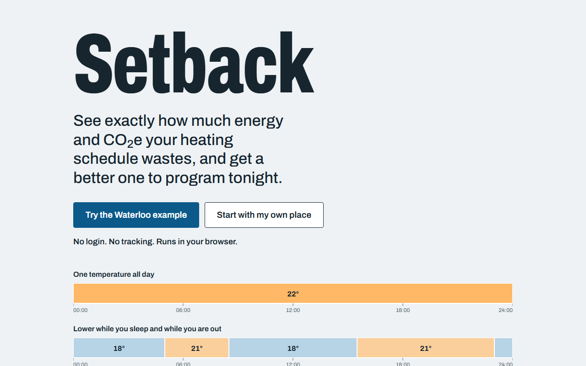
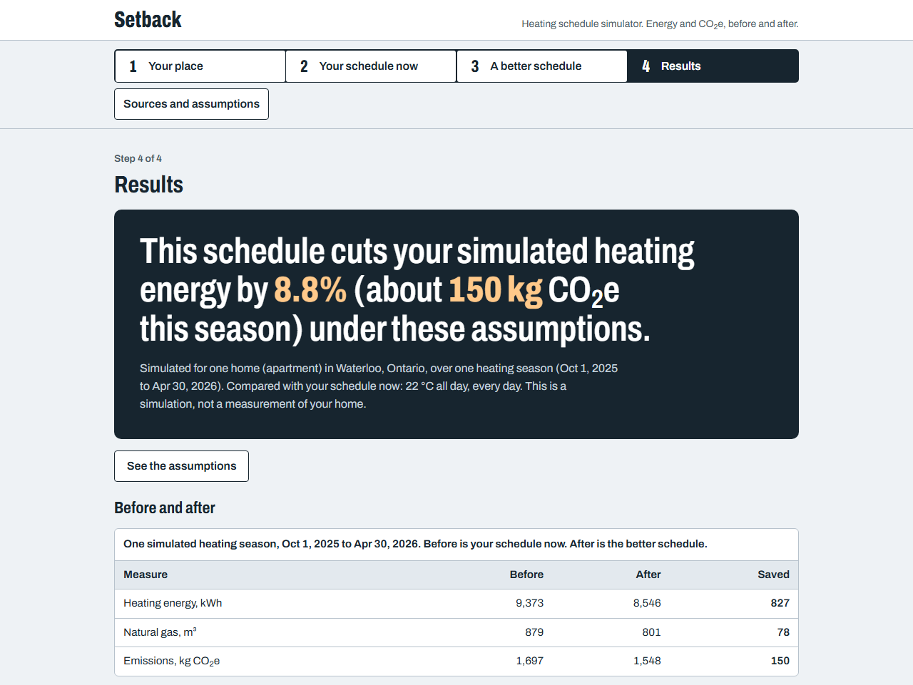
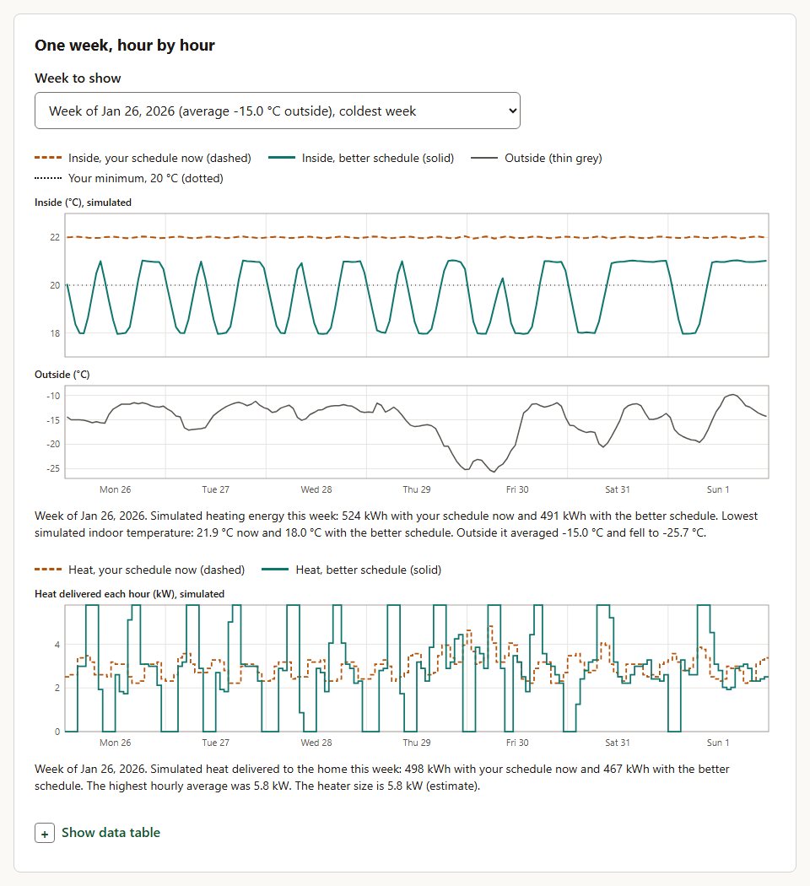
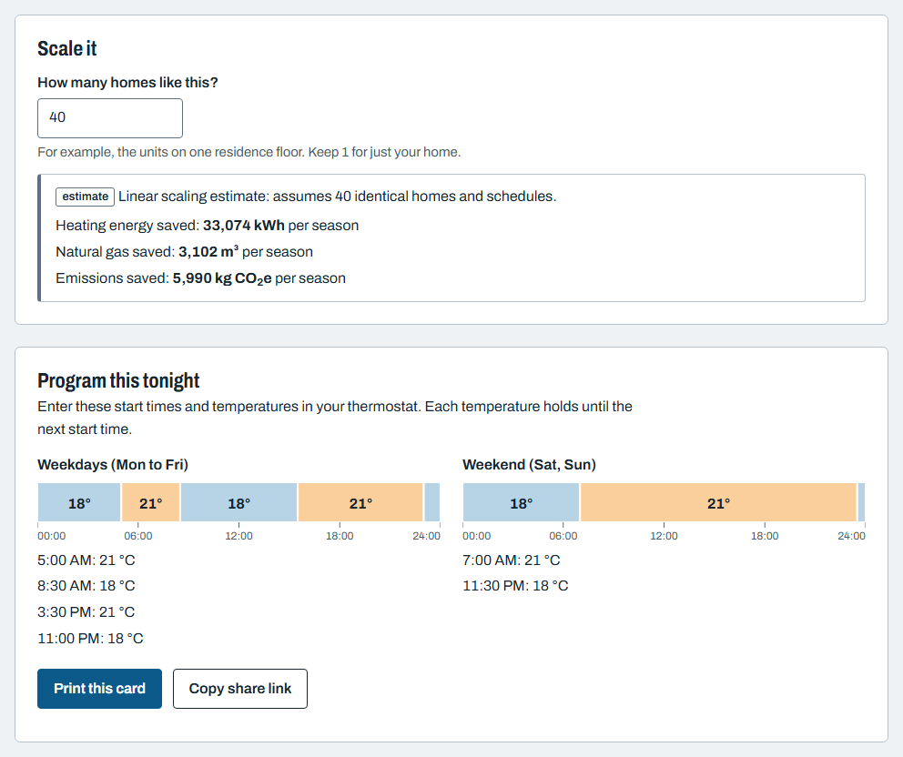
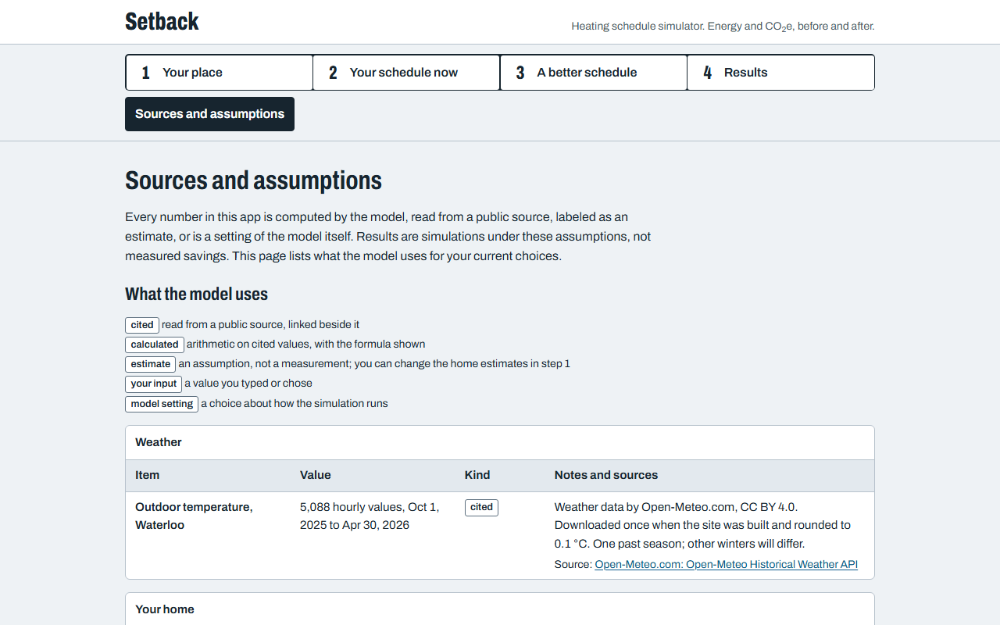

# Setback

Setback is a small web app that shows how much heating energy and CO2e a thermostat schedule wastes, and suggests a better schedule you can program tonight. You pick a city, a home type and a heating type, enter the schedule you use now, and compare it with a setback schedule over one real heating season of hourly weather. Every result is a simulation under stated assumptions, with every constant cited or labeled as an estimate.

- Live app: https://setback-mocha.vercel.app
- Demo video: VIDEO_URL_HERE
- Source code: https://github.com/DylanRolfe/setback
- Built for [Green Shift Hacks](https://green-shift-hacks.devpost.com/) by Dylan Rolfe (solo entry).

## Screenshots







## Use it in 30 seconds

1. Open https://setback-mocha.vercel.app and click **Try the Waterloo example**. (Or click **Start with my own place** and fill in steps 1 to 3.)
2. Read the headline in **4 Results**: "This schedule cuts your simulated heating energy by X% (about Y kg CO2e this season) under these assumptions."
3. Scroll down: "Before and after", "Comfort check", "One week, hour by hour" (it opens on the coldest week), "Why this works", "Sanity check" and "Scale it".
4. Go to **Program this tonight**. Print the card or copy the share link. The link holds all your inputs in the URL. Nothing is sent to a server.
5. Open **Sources and assumptions** to see every constant, its source, and the limits of the model.

To use your own home: **1 Your place** (city, home type, heating type, and "Adjust the estimates" if you know better numbers), **2 Your schedule now**, **3 A better schedule** (click "Suggest a schedule", then edit it if you like).

## The environmental benefit

Space heating burns fuel for every degree a home is kept above the outdoor temperature. A lower temperature while people are asleep or out means less heat lost, so less gas burned or less electricity used. Setback turns that into a specific schedule and a number.

The documented example below is a **simulation, not a measured saving**. The routine is an illustrative example, not a real user.

Inputs: Waterloo, Ontario. Apartment preset (heat loss UA 80 W/K, thermal mass C 11.6 MJ/K, heater 5.8 kW, all estimates). Gas furnace at 95% efficiency. Hourly weather from Oct 1, 2025 to Apr 30, 2026. Comfort minimum 20 °C while home and awake.

- Before: 22 °C all day, every day.
- After (the app's suggestion): weekdays 5:00 AM 21 °C, 8:30 AM 18 °C, 3:30 PM 21 °C, 11:00 PM 18 °C. Weekends 7:00 AM 21 °C, 11:30 PM 18 °C.

| Per apartment, per season | Before | After | Saved |
| --- | --- | --- | --- |
| Gas energy | 9,373 kWh | 8,546 kWh | 827 kWh (8.8%) |
| Natural gas | 879 m³ | 801 m³ | 78 m³ |
| CO2e | 1,697 kg | 1,548 kg | 150 kg |
| Mean indoor temperature | 22.0 °C | 20.1 °C | |
| Hours below 20 °C while home and awake (of 1,934) | 0 | 6.9 | |

Each figure is rounded on its own, which is why the CO2e saving reads 150 kg and not 149 kg.

**Scale it.** Multiplied by 40 identical units (for example a residence floor), that is about 3,100 m³ of gas and about 5,990 kg CO2e per season. This is a straight multiplication. It assumes identical homes and schedules.

These numbers are pinned by a test (`lib/sim/__tests__/example.test.ts`). If the model, the weather file or a factor changes, the test fails and this README must be updated. Every input and source is listed in [`docs/SOURCES.md`](docs/SOURCES.md), section 8.

## How the model works

The home is one zone with one heat-loss number and one thermal-mass number (a "1R1C" model):

```
C * dT/dt = Q_heat - UA * (T - T_out)
```

- `T` is the indoor temperature. `T_out` is the outdoor temperature from real hourly weather, held constant within each hour.
- `UA` is the heat-loss coefficient in W/K. `C` is the thermal mass in J/K.
- `Q_heat` is the heater output: full power when the thermostat calls for heat, otherwise zero.

**Exact step.** The season is 5,088 hours, run in 60-second steps. Inside a step the inputs are constant, so the equation has an exact answer: the room moves toward `T_eq = T_out + Q_heat / UA` with time constant `tau = C / UA`:

```
T(t + dt) = T_eq + (T(t) - T_eq) * exp(-dt / tau)
```

Using the exact answer (not a numerical approximation) means heat in equals heat lost plus heat stored, to rounding error. Tests check this for a single step and for the whole season.

**Thermostat.** On/off with a 0.5 °C deadband. The heat turns on 0.25 °C below the set temperature and off 0.25 °C above it.

**Heating systems.**

- Gas furnace: fuel energy = heat / efficiency. Cubic metres = fuel energy / 38.39 MJ per m³.
- Electric baseboard: electricity = heat.
- Air-source heat pump: electricity = heat / COP, where COP depends on the outdoor temperature (3.7 at 8 °C, 2.4 at -8 °C, 1.0 at -25 °C, straight lines between, never below 1). This curve is an estimate built from NRCan's published ranges.

**Emissions.** Gas: m³ × kg CO2e per m³ for the province (Ontario: 1.931 kg CO2e per m³, combustion only). Electricity: kWh × the province's grid intensity (Ontario 73, Quebec 2.6, Alberta 346, British Columbia 18 g CO2e per kWh).

**Comfort check.** The app counts the hours when the person is home and awake (from their routine) and the simulated room is below their comfort minimum.

**Suggested schedule.** 21 °C when home and awake, 3 °C lower when asleep or out (2 °C for heat pumps), never below 17 °C. This stays inside NRCan's advice: "In general, it is best not to reduce the temperature lower than 17°C (63°F), as there is a risk of moisture build-up in the exterior walls." ([Keeping the Heat In, section 9.1.2](https://www.canada.ca/en/environment-climate-change/services/energy-efficiency/home-energy-efficiency/keeping-heat.html)). The warm-up lead time (30 to 180 minutes) is chosen by simulation: the shortest lead time that keeps the room below the comfort minimum for at most 1% of home-and-awake hours.

**Why a setback saves energy.** Heat loss is proportional to the gap between indoors and outdoors. A cooler room for some hours loses less heat in total. Warming it back up only replaces the heat stored in the building, which is less than the loss that was avoided.

## Sanity check: the model lands below published figures

The app runs two published test cases through the model and shows the result next to the published figure. For the Waterloo example:

| Test case | Published figure | This model | Verdict |
| --- | --- | --- | --- |
| 22 °C all day versus 21 °C from 11 p.m. to 7 a.m. | NRCan: "about 2 percent" (read as 1.5% to 2.5%) | 1.4% | Below |
| 22 °C all day versus 18 °C from 11 p.m. to 6 a.m. | CMHC test house, Ottawa: 6.5% (read as 6.0% to 7.0%) | 3.3% | Below |

NRCan's exact words: "A drop of 1°C (2°F) over an eight-hour period can save about 2 percent on your heating energy consumption." ([Keeping the Heat In, section 9.1.2](https://www.canada.ca/en/environment-climate-change/services/energy-efficiency/home-energy-efficiency/keeping-heat.html)). The CMHC figure is from [Research Highlight, Technical Series 05-100](https://assets.cmhc-schl.gc.ca/sf/project/archive/publications/rhse-penrse/63816.pdf).

**The model lands below both.** We think two things explain most of the gap:

1. The model leaves out free heat from the sun, people and appliances. In a real home that free heat covers part of the loss, so the furnace's share is smaller and the same setback is a larger percentage of it.
2. One thermal mass makes the room cool slowly (time constant 25 to 40 hours for the presets), so the simulated room spends less of the night at the lower temperature than a real room would.

Both effects make Setback's percentage **lean low**. The model was not tuned up to match, because that would mean adding assumptions that cannot be cited. Across the five cities the NRCan case gives 1.3% to 2.0% for the apartment preset with a gas furnace (inside NRCan's range only for Vancouver). The CMHC figure is one house, one city and one winter, so it is context, not a pass/fail test.

## Data sources and licences

Full list, with every value, table number and quote: [`docs/SOURCES.md`](docs/SOURCES.md). Each cited value was read on the live source on 2026-11-15.

| Data | Source | Licence or terms |
| --- | --- | --- |
| Hourly outdoor temperature, 5 cities, Oct 1, 2025 to Apr 30, 2026 | [Open-Meteo Historical Weather API](https://open-meteo.com/en/docs/historical-weather-api) | CC BY 4.0 |
| Natural gas emission factors; grid electricity intensity by province | ECCC, National Inventory Report 1990–2024, [Annex 6](https://data-donnees.az.ec.gc.ca/data/substances/monitor/canada-s-official-greenhouse-gas-inventory/D-Emission-Factors/?lang=en) and [Annex 7](https://data-donnees.az.ec.gc.ca/data/substances/monitor/canada-s-official-greenhouse-gas-inventory/C-Tables-Electricity-Canada-Provinces-Territories/?lang=en) | Open Government Licence – Canada |
| Gas energy content; global warming potentials | ECCC, [Emission factors and reference values v4.0](https://www.canada.ca/en/environment-climate-change/services/climate-change/pricing-pollution-how-it-will-work/output-based-pricing-system/federal-greenhouse-gas-offset-system/emission-factors-reference-values.html); [Global warming potentials](https://www.canada.ca/en/environment-climate-change/services/climate-change/greenhouse-gas-emissions/quantification-guidance/global-warming-potentials.html) | Government of Canada terms, reproduced with credit |
| Setback guidance and quotes | Natural Resources Canada: [Keeping the Heat In](https://www.canada.ca/en/environment-climate-change/services/energy-efficiency/home-energy-efficiency/keeping-heat.html), [Smart thermostats](https://natural-resources.canada.ca/energy-efficiency/energy-star/products/list-certified-products/smart-thermostats), [Heating and cooling with a heat pump](https://natural-resources.canada.ca/energy-efficiency/energy-star/heating-cooling-heat-pump) | Government of Canada terms, short quotes with credit |
| Test-house comparison | [CMHC Technical Series 05-100](https://assets.cmhc-schl.gc.ca/sf/project/archive/publications/rhse-penrse/63816.pdf) | CMHC terms, figures with credit |
| Furnace efficiencies | [Energy Efficiency Regulations, 2016, s. 259](https://laws-lois.justice.gc.ca/eng/regulations/SOR-2016-311/section-259.html); NRCan, [Heating with Gas](https://natural-resources.canada.ca/sites/nrcan/files/energy/pdf/energystar/Heating_With_Gas.pdf) | Federal law and Government of Canada terms, with credit |
| Plausibility range for the home presets | NRCan, [Comprehensive Energy Use Database, Ontario, 2023](https://oee.nrcan.gc.ca/corporate/statistics/neud/dpa/menus/trends/comprehensive/trends_res_on.cfm) | Open Government Licence – Canada |
| Thermal mass classes (ISO 13790 values) | [LBNL Modelica Buildings Library](https://simulationresearch.lbl.gov/modelica/releases/v10.1.1/help/Buildings_ThermalZones_ISO13790_Data.html) | Library licence, values quoted with credit |
| Where to find Ontario energy prices (optional user input) | Ontario Energy Board: [electricity rates](https://www.oeb.ca/consumer-information-and-protection/electricity-rates), [natural gas rates](https://www.oeb.ca/consumer-information-and-protection/natural-gas-rates) | Credited to the OEB as its website terms require |

The home presets (UA, C, heater size), the thermostat deadband, the default routine and the heat pump curve are **estimates**. The app labels them "estimate" and lets you change the main ones.

## Run it locally

Needs Node.js 20.9 or newer (built with Node 22).

```bash
npm install          # install dependencies
npm run dev          # start the dev server at http://localhost:3000
npm test             # run the 54 unit tests for the simulation (Vitest)
npm run build        # build the static site into out/
npm run lint         # ESLint
npm run typecheck    # TypeScript, no emit
npm run fetch-weather  # optional: re-download the five weather files from Open-Meteo
npm run qa           # optional: 252 browser checks (Playwright + axe-core) on the built site; first run `npx playwright install chromium`
```

The browser checks and what they found are written up in [docs/QA.md](docs/QA.md). To run them against the live site: `BASE_URL=https://setback-mocha.vercel.app npm run qa`.

The build is a static export. There is no backend, no database, no LLM, no analytics, no cookies and no runtime API call. Weather is downloaded once at build time and shipped as static JSON in `public/data/`. You can host the `out/` folder on any static file host.

`npm run fetch-weather` needs an internet connection and no API key. If Open-Meteo has revised its archive, the numbers can shift slightly. The pinned example test will then fail, and the documents must be updated to match.

## Project structure

```
app/                  page shell, metadata, global styles (Tailwind CSS 4, print styles)
components/           all UI: steps, schedule editor, results, SVG charts, action card, sources view
lib/sim/              the simulation, pure TypeScript, runs in the browser
  model.ts            1R1C exact-step model, thermostat, simulate(), compare()
  schedule.ts         weekly setpoints, routine, suggested schedule
  heating.ts          gas, electric and heat pump input energy
  weather.ts          local time from the weather file, week list
  factors.ts          cited emission factors and the sources registry
  presets.ts          cities, home presets (estimates), defaults
  scenario.ts         scenario to simulation runs, the sanity check
  assumptions.ts      rows of the "Sources and assumptions" view, and the limitations list
  __tests__/          Vitest unit tests
lib/share.ts          encode and decode the scenario in the URL hash
public/data/          weather-<city>.json (CC BY 4.0) and NOTICE.md
scripts/              fetch-weather.mjs, the build-time weather download
docs/                 PLAN.md, SOURCES.md, DEVPOST.md, VIDEO_SCRIPT.md, captions.srt, SHOTLIST.md, CHECKLIST.md
```

Stack: Next.js 16.4.6 (App Router, static export), React 19.3, TypeScript 5, Tailwind CSS 4, Vitest 5, hand-written SVG charts, hosted on Vercel's free tier. Browser and accessibility checks (Playwright and axe-core) are recorded in `docs/QA.md`.

## Limitations

- These are simulations, not measured savings. Nobody's meter was read.
- The home is modeled as a single zone: one indoor temperature, one heat-loss number (UA) and one thermal-mass number (C). Real homes have warm and cold rooms.
- The UA and C presets are estimates, not measurements of your home. Your results depend on them.
- Free heat from the sun, people and appliances is not modeled, and neither is heat shared with neighbouring units. This makes the percentage saving lean low: the model lands at or below the published figures it is checked against.
- The heat pump efficiency curve is approximate. Backup heat that some heat pumps switch on while warming back up is not modeled, so heat pump savings may be overstated. NRCan advises setbacks of no more than 2 °C for heat pumps.
- Humidity and how warm a room feels are not modeled. NRCan advises not going below 17 °C because of moisture risk in outside walls.
- Furnace fan electricity, pilot lights and duct losses are not counted.
- Gas emissions cover burning the gas only. Grid emissions use a yearly provincial average, not the hour-by-hour mix.
- The weather is one past heating season (October 2025 to April 2026). A colder or milder winter changes the totals.
- Savings only happen if the schedule is actually programmed and left running. Renters who cannot control their thermostat cannot act on it.
- "Scale it" multiplies one home by a number. It assumes identical homes and schedules.

## AI assistance disclosure

Setback was built by Dylan Rolfe using an AI coding agent (Claude Fable 5.2, in Claude Code) with sub-agents for research, frontend, QA and submission text. The agent and its sub-agents wrote the code, the tests and the first drafts of the documents, working from Dylan's project brief. No AI model runs inside the product.

[DYLAN: edit the sentence above if you wrote or rewrote parts by hand.]

**What Dylan decided:**

- The idea and the target user: a renter or student in a cold Canadian city who controls a thermostat.
- The single impact to target: wasted space-heating energy and CO2e.
- The modeling approach: a transparent single-zone 1R1C thermal model driven by real hourly weather, with an on/off thermostat and three heating types (gas furnace, electric baseboard, heat pump).
- The demo flow.
- What is out of scope: accounts, databases, smart-thermostat or utility APIs, cooling, multi-zone models, hardware, chatbots, gamification.
- The stack: Next.js static export on Vercel, TypeScript, no backend, no LLM in the product.
- The honesty rules and the limitations to state.
- That he records the video and submits the project himself.

**What Dylan reviewed:**

CONFIRM BEFORE SUBMITTING (Dylan: tick only what is true, delete what is not, then delete this line)

- [ ] I opened the live app and ran the full flow, from the Waterloo example to the share link.
- [ ] I read every source in `docs/SOURCES.md` and opened the quoted NRCan pages to check the quotes.
- [ ] I read this README and the Devpost text, and they match what the app does.
- [ ] I recorded the demo video myself.

## Credits

- Weather data by [Open-Meteo.com](https://open-meteo.com/), licensed [CC BY 4.0](https://creativecommons.org/licenses/by/4.0/). Zippenfenig, P. (2023). Open-Meteo.com Weather API. Zenodo. doi:10.5281/ZENODO.7970649. Contains Copernicus Climate Change Service information (ERA5, ERA5-Land). Changes made: trimmed to the local heating season and rounded to 0.1 °C.
- Emission factors and energy-use statistics: Environment and Climate Change Canada and Natural Resources Canada. Contains information licensed under the [Open Government Licence – Canada](https://open.canada.ca/en/open-government-licence-canada).
- Guidance quotes: Natural Resources Canada. Test-house figure: Canada Mortgage and Housing Corporation.
- Energy price pointers: Ontario Energy Board.
- Thermal mass class values: Lawrence Berkeley National Laboratory, Modelica Buildings Library.
- Open-source tools: Next.js (started from `create-next-app`), React, TypeScript, Tailwind CSS, Vitest, ESLint.

## Licence

Code: [MIT](LICENSE). The weather files in `public/data/` are derived from Open-Meteo data and are licensed CC BY 4.0, not MIT. See [`public/data/NOTICE.md`](public/data/NOTICE.md).
